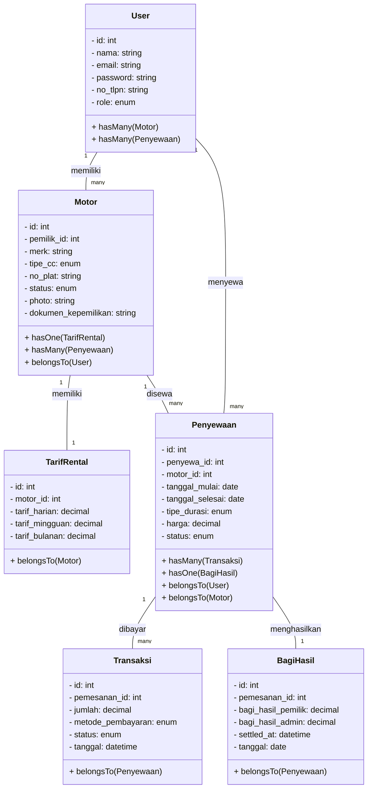

# Alur Kerja Proyek — Sistem Penyewaan Motor

Dokumen ini menjelaskan alur kerja, arsitektur, dan alur bisnis dari aplikasi web **Sistem Penyewaan Motor** berbasis Laravel.

---

## 1. Ringkasan Proyek

Aplikasi web penyewaan motor yang menghubungkan tiga peran pengguna:

| Peran | Deskripsi |
|-------|-----------|
| **Penyewa** | Pelanggan yang mencari dan menyewa motor |
| **Pemilik** | Pemilik kendaraan yang menitipkan motor untuk disewakan |
| **Admin** | Pengelola usaha penyewaan (verifikasi, tarif, konfirmasi, laporan) |

Alur end-to-end: pendaftaran motor → verifikasi admin → pemesanan penyewa → pembayaran → pemakaian → pengembalian → laporan pendapatan & bagi hasil.

---

## 2. Stack Teknologi

| Komponen | Teknologi |
|----------|-----------|
| Backend / Framework | Laravel 12 (PHP ^8.2) |
| Database | MySQL / MariaDB (sqlite untuk development) |
| Auth | Laravel Sanctum (API), Session guard (web) |
| Frontend templating | Blade |
| Styling | Tailwind CSS v4 via Vite |
| Build tool | Vite |
| Charting | Chart.js |
| HTTP Client | Axios |
| Testing | PHPUnit |

---

## 3. Struktur Direktori Utama

```
app/
  Http/Controllers/
    Admin/        # Dashboard, Motor, Rental, Payment, Report, User
    Owner/        # Dashboard, Motor, Rental, Revenue
    Tenant/       # Dashboard, Marketplace, Rental, Payment
    AuthController.php
    ProfileController.php
    FileController.php
  Models/         # User, Motor, Penyewaan, TarifRental, Transaksi, BagiHasil
  helpers.php     # Helper global (contoh: rupiah())
database/
  migrations/
  seeders/
routes/
  web.php         # Rute Blade (SSR)
  api.php         # Rute REST API (prefix /api dan /api/v1)
resources/views/
  layouts/
  owner/          # Dashboard owner
  tenant/         # Dashboard penyewa
  admin/          # Dashboard admin
public/
tests/
```

---

## 4. Model Data & Relasi

Tabel inti menurut PRD:

| Tabel | Keterangan |
|-------|------------|
| `users` | Akun pengguna (role: penyewa / pemilik / admin) |
| `motors` | Motor yang dititipkan pemilik |
| `tarif_rental` | Tarif harian / mingguan / bulanan per motor |
| `penyewaan` | Data pesanan sewa |
| `transaksi` | Data pembayaran |
| `bagi_hasil` | Catatan bagi hasil pemilik & admin |

Relasi Eloquent (menurut PRD):

- `User` hasMany `Motor` (pemilik)
- `User` hasMany `Penyewaan` (penyewa)
- `Motor` hasOne `TarifRental`
- `Motor` hasMany `Penyewaan`
- `Penyewaan` hasMany `Transaksi`
- `Penyewaan` hasOne `BagiHasil`

Status penyewaan: `menunggu_pembayaran` → `menunggu_konfirmasi` → `berjalan` → `selesai` (atau `dibatalkan`).

Status motor: `menunggu_verifikasi` → `tersedia` ⇄ `disewa` / `perawatan` (atau `ditolak`).

---

## 5. Rute Aplikasi

### 5.1 Rute Web (`routes/web.php`)

**Publik (Marketplace)**
- `GET /` — Halaman beranda
- `GET /motors` — Daftar motor tersedia
- `GET /motors/{motor}` — Detail motor

**Autentikasi**
- `GET /login`, `POST /login`
- `GET /register`, `POST /register`
- `POST /logout`

**Umum (terlindungi auth)**
- `GET /profile`, `PUT /profile`, `PUT /profile/password`
- `GET /files/motor-document/{motor}`
- `GET /files/payment-proof/{transaksi}`

**Tenant (`/tenant`, role: penyewa)**
- `/dashboard`, `/rentals`, `/motors/{motor}/rent`, `/rentals/{rental}`, `/payments`, ...

**Owner (`/owner`, role: pemilik)**
- `/dashboard`, `/motors` (resource), `/rentals`, `/revenue`

**Admin (`/admin`, role: admin)**
- `/dashboard`, `/users` (resource), `/motors`, `/rentals`, `/payments`, `/reports/...`

### 5.2 Rute API (`routes/api.php`)

Prefix `/api` dan alias `/api/v1`. Grup berdasarkan peran dengan middleware `auth:sanctum` + `role:...`.

- `POST /auth/register`, `POST /auth/login`, `POST /auth/logout`
- `GET /motors`, `GET /motors/{motor}` (publik)
- `POST /owner/motors`, `GET /owner/motors`, `GET /owner/revenue`, ...
- `POST /bookings`, `POST /payments`, `GET /bookings/history`, ...
- `PATCH /admin/motors/{id}/verify`, `PATCH /admin/bookings/{id}/confirm`, ...

Standar respons: JSON `{ success, message, data }` dengan kode HTTP yang sesuai.

---

## 6. Matriks Hak Akses

| Fitur | Admin | Pemilik | Penyewa |
|-------|-------|---------|---------|
| Registrasi / Login / Logout | ✓ | ✓ | ✓ |
| CRUD User | ✓ | — | — |
| CRUD Motor | ✓ | ✓ (milik sendiri) | — |
| CRUD Tarif Rental | ✓ | — | — |
| CRUD Penyewaan | ✓ | — | ✓ (milik sendiri) |
| CRUD Pembayaran | ✓ | — | — |
| Entri Transaksi Manual | ✓ | — | — |
| Lihat Bagi Hasil | ✓ | ✓ | — |
| Grafik Penyewaan | ✓ | — | — |
| Cetak / Ekspor Laporan | ✓ | ✓ | ✓ |

Admin dibuat langsung via seeder (tidak melalui registrasi publik).

---

## 7. Alur Bisnis (6 Alur Sistem)

### 7.1 Alur 1 — Pendaftaran Motor (Pemilik)
1. Pemilik login → halaman `owner/motors` create.
2. Isi form: merek, tipe cc (100/125/150), no plat, foto, dokumen kepemilikan.
3. Simpan → status motor: `menunggu_verifikasi`.
4. Antrean verifikasi ditampilkan ke Admin.

### 7.2 Alur 2 — Verifikasi & Tarif (Admin)
1. Admin buka `/admin/motors`, lihat motor menunggu verifikasi.
2. Setujui atau tolak → status `tersedia` atau `ditolak`.
3. Admin menetapkan tarif harian/mingguan/bulanan per motor (`tarif_rental`).

### 7.3 Alur 3 — Pencarian & Pemesanan (Penyewa)
1. Penyewa buka `/motors`, filter merek dan cc.
2. Pilih motor tersedia → pilih paket durasi + tanggal mulai.
3. Sistem hitung total biaya otomatis (`fn_hitung_biaya` / stored procedure).
4. Validasi bentrok jadwal: motor tidak boleh dipesan pada rentang yang terisi.
5. Buat penyewaan dengan status `menunggu_pembayaran`.

### 7.4 Alur 4 — Pembayaran & Konfirmasi (Penyewa + Admin)
1. Penyewa pilih metode pembayaran (transfer / e-wallet / tunai, simulasi).
2. Unggah bukti pembayaran → status `pending`.
3. Admin konfirmasi pembayaran dan pesanan → status `berjalan`, motor jadi `disewa`.

### 7.5 Alur 5 — Pengembalian Motor (Admin)
1. Setelah waktu sewa habis, motor dikembalikan.
2. Admin konfirmasi pengembalian (`confirmReturn`).
3. Status penyewaan jadi `selesai`, motor kembali `tersedia`.
4. Sistem otomatis mencatat `bagi_hasil` (70% pemilik, 30% admin) via trigger/stored procedure.

### 7.6 Alur 6 — Laporan
- **Penyewa:** riwayat penyewaan, status aktif, pembayaran.
- **Pemilik:** daftar motor, pendapatan per motor, total bagi hasil.
- **Admin:** jumlah motor, motor disewa, total pendapatan, grafik penyewaan per periode.
- Semua laporan dapat difilter periode dan dicetak / diekspor CSV.

---

## 8. Alur Pengembangan (Development Workflow)

### 8.1 Setup Awal
```bash
# Clone repositori
git clone <repo-url> Ujikom-Ridwan
cd Ujikom-Ridwan

# Install dependensi PHP
composer install

# Install dependensi frontend
npm install

# Salin environment
cp .env.example .env
# Edit .env (DB, APP_URL, dll.)

# Generate kunci aplikasi
php artisan key:generate

# Jalankan migrasi dan seeder
php artisan migrate --seed

# Jalankan server development
php artisan serve

# Jalankan Vite (dev mode)
npm run dev
```

### 8.2 Menjalankan Secara Bersamaan (dev script)
```bash
composer run dev
```
Menjalankan secara bersamaan: server Laravel, queue worker, pail (log), dan Vite.

### 8.3 Build Produksi
```bash
npm run build
php artisan config:cache
php artisan route:cache
php artisan view:cache
```

### 8.4 Database & Seeder
- Migrasi: `database/migrations/`
- Seeder: `database/seeders/` (termasuk akun Admin dan data dummy)
- Stored procedure / function / trigger / view dibuat di dalam migration menggunakan `DB::unprepared()`.

### 8.5 Testing
```bash
# Unit / feature test
php artisan test

# Atau phpunit
vendor/bin/phpunit
```

Pengujian manual merujuk pada instrumen uji (No, Skenario, Class, Method, Data Input, Expected Result, Actual Result, Status) yang tercakup dalam PRD bagian 13.

---

## 9. Tanggung Jawab Controller (Ringkasan)

| Controller | Ruang Lingkup |
|------------|---------------|
| `AuthController` | Login, register, logout (web + API) |
| `ProfileController` | Edit profil, ganti password |
| `FileController` | Unduh dokumen motor & bukti pembayaran (secure) |
| `Admin\DashboardController` | Ringkasan admin + grafik |
| `Admin\UserController` | CRUD user, toggle active |
| `Admin\MotorController` | Verifikasi motor, tarif, status |
| `Admin\RentalController` | Konfirmasi pesanan, ongoing, return, cancel |
| `Admin\PaymentController` | CRUD pembayaran, konfirmasi, tolak |
| `Admin\ReportController` | Laporan revenue, pembayaran, bagi hasil, settle |
| `Owner\DashboardController` | Ringkasan pemilik (motor, disewa, bagi hasil) |
| `Owner\MotorController` | CRUD motor milik sendiri |
| `Owner\RentalController` | Daftar penyewaan milik pemilik |
| `Owner\RevenueController` | Laporan bagi hasil pemilik |
| `Tenant\DashboardController` | Ringkasan penyewa (sewa aktif, biaya) |
| `Tenant\MarketplaceController` | Beranda & daftar motor publik |
| `Tenant\RentalController` | Pesan, quote, batalkan, detail sewa |
| `Tenant\PaymentController` | Buat pembayaran, riwayat pembayaran |

---

## 10. Alur Keamanan

- SQL injection dicegah dengan Eloquent / Query Builder (parameter binding).
- Password disimpan dengan `Hash::make` dan dicek dengan `Hash::check`.
- Output otomatis di-escape oleh Blade (perlindungan XSS).
- CSRF protection bawaan (`@csrf`) pada semua form web.
- Validasi upload file via Form Request (mime type, ukuran maksimal) dan penyimpanan via Laravel `Storage`.
- Otorisasi per peran di sisi server melalui middleware `role:`, Gate, dan Policy.
- Rute API dilindungi dengan middleware `auth:sanctum`.

---

## 11. Design Tokens (UI/UX)

| Token | Nilai | Pemakaian |
|-------|-------|-----------|
| `--bg` | `#FFFFFF` | Latar halaman |
| `--ink` | `#0B0B0B` | Teks utama |
| `--ink-muted` | `#6B7280` | Teks sekunder |
| `--accent` | `#86EF72` | Hijau muda (CTA utama) |
| `--accent-soft` | `#EAFBE7` | Latar badge / hover |
| `--border` | `#E5E7EB` | Border kartu & input |
| Radius | 10px kartu, 8px input, 999px tombol | — |

Referensi visual: gaya landing "Kiwi" (bersih, lapang, putih dominan, line-art hitam dengan aksen hijau).

---

## 12. Kriteria Penerimaan (Acceptance Criteria)

1. Keenam alur sistem berjalan lengkap dari data awal sampai laporan.
2. Setiap peran hanya dapat mengakses fitur sesuai matriks hak akses.
3. Biaya sewa dan bagi hasil dihitung otomatis dan akurat.
4. Tampilan konsisten dengan design tokens dan responsif (mobile-first).
5. Seluruh skenario uji manual berstatus OK; tidak ada celah SQL injection pada login.
6. Dokumentasi, diagram, dan database lengkap dan dapat didemokan.

---

## 13. Class Diagram (Diagram Kelas)

Class diagram menggambarkan struktur statis aplikasi: kelas, atribut, method, dan relasi antar kelas. Dalam proyek ini, kelas utama dirisetel sebagai model Eloquent yang memetakan tabel database.

### 13.1 Kelas Utama (Model Eloquent)

| Kelas | Tabel | Atribut Utama | Fungsi |
|-------|-------|---------------|--------|
| `User` | `users` | id, nama, email, password, no_tlpn, role | Mengelola akun pengguna dan autentikasi |
| `Motor` | `motors` | id, pemilik_id, merk, tipe_cc, no_plat, status, photo, dokumen_kepemilikan | Merepresentasikan motor yang dititipkan |
| `TarifRental` | `tarif_rental` | id, motor_id, tarif_harian, tarif_mingguan, tarif_bulanan | Menyimpan tarif sewa per motor |
| `Penyewaan` | `penyewaan` | id, penyewa_id, motor_id, tanggal_mulai, tanggal_selesai, tipe_durasi, harga, status | Data pesanan sewa penyewa |
| `Transaksi` | `transaksi` | id, pemesanan_id, jumlah, metode_pembayaran, status, tanggal | Data pembayaran sewa |
| `BagiHasil` | `bagi_hasil` | id, pemesanan_id, bagi_hasil_pemilik, bagi_hasil_admin, settled_at, tanggal | Catatan bagi hasil pemilik & admin |

### 13.2 Relasi Antar Kelas



### 13.3 Fungsi Class Diagram

- Memodelkan entitas bisnis sebagai objek agar kode terstruktur dengan pola OOP.
- Membantu developer memahami relasi antar data sebelum implementasi.
- Dasar pembuatan migration, model Eloquent, dan relasi database.
- Dokumentasi arsitektur yang dapat ditampilkan kepada asesor/demo.

---

## 14. Tipe Data (String, Number, Boolean, Array)

Dalam kode aplikasi (PHP/Laravel dan JavaScript) tipe data berikut digunakan:

| Tipe Data | Contoh | Fungsi |
|-----------|--------|--------|
| **String** | `"Honda Beat"`, `"selesai"`, `'@gmail.com'` | Menyimpan teks: nama motor, email, status, pesan error, dll. |
| **Number** (int / float / decimal) | `125`, `80000.00`, `3` | Menyimpan angka: cc motor, tarif, jumlah hari, total biaya, id. |
| **Boolean** | `true`, `false` | Menyimpan kondisi benar/salah: apakah motor tersedia, apakah login sukses, dll. |
| **Array** | `['100', '125', '150']`, `[1, 2, 3]` | Menyimpan koleksi data: daftar cc, daftar motor, daftar status penyewaan. |

### Contoh Penggunaan dalam Kode

**PHP (Laravel):**
```php
$role = 'pemilik';           // string
$cc = 125;                   // number (int)
$tarif = 80000.00;           // number (float)
$isAvailable = true;         // boolean
$ccOptions = ['100', '125', '150']; // array
```

**JavaScript (Blade/Chart.js):**
```js
const role = 'penyewa';      // string
const durasi = 3;            // number
const isPaid = false;        // boolean
const labels = ['Jan', 'Feb', 'Mar']; // array
```

---

## 15. Kondisi dan Perulangan (if, while, for)

Struktur kontrol digunakan untuk menentukan alur eksekusi program berdasarkan kondisi dan untuk mengulang proses.

### 15.1 Kondisi `if`

`if` mengevaluasi kondisi bernilai boolean. Jika benar (`true`), blok kode di dalamnya dieksekusi.

**Fungsi:** Membuat keputusan dalam program, mis. memeriksa role user sebelum mengizinkan akses halaman admin.

**Contoh PHP (Blade):**
```php
@if($user->role === 'admin')
    <!-- Tampilkan menu admin -->
@elseif($user->role === 'pemilik')
    <!-- Tampilkan menu pemilik -->
@else
    <!-- Tampilkan menu penyewa -->
@endif
```

**Contoh JavaScript:**
```js
if (status === 'berjalan') {
    // Tombol pengembalian ditampilkan
}
```

### 15.2 Perulangan `while`

`while` mengulang blok kode selama kondisi bernilai benar.

**Fungsi:** Memproses data hingga kondisi terpenuhi, mis. menunggu konfirmasi pembayaran atau memproses antrean verifikasi motor satu per satu.

**Contoh konseptual PHP:**
```php
while ($motor->status === 'menunggu_verifikasi') {
    // Proses verifikasi atau hentikan antrean
    break;
}
```

### 15.3 Perulangan `for`

`for` mengulang blok kode dengan jumlah iterasi yang sudah diketahui, biasanya digunakan untuk traversing array.

**Fungsi:** Menampilkan daftar item berulang, mis. menampilkan 12 bulan pada grafik Chart.js atau daftar motor dalam tabel.

**Contoh JavaScript (Chart.js labels):**
```js
for (let i = 0; i < labels.length; i++) {
    console.log(labels[i]);
}
```

**Contoh PHP (Blade @foreach, setara dengan for):**
```blade
@foreach($motors as $motor)
    <tr>
        <td>{{ $motor->merk }}</td>
        <td>{{ $motor->status }}</td>
    </tr>
@endforeach
```

### 15.4 Ringkasan Fungsi Struktur Kontrol

| Struktur | Fungsi Utama |
|----------|--------------|
| `if` / `elseif` / `else` | Percabangan berdasarkan kondisi boolean |
| `while` | Pengulangan bersyarat sampai kondisi salah |
| `for` / `@foreach` | Pengulangan dengan jumlah iteration diketahui atau melalui koleksi |

---

## 16. Fungsi dan Prosedur

Fungsi dan prosedur adalah blok kode yang dapat digunakan kembali untuk menyelesaikan tugas tertentu.

### 16.1 Fungsi (Function)

Fungsi adalah blok kode yang menerima input (parameter), memprosesnya, dan **mengembalikan nilai (return)**.

**Fungsi:** Memisahkan logika agar reusable, memudahkan pengujian, dan menghindari duplikasi kode.

**Contoh PHP:**
```php
function hitungBiaya($tarifHarian, $jumlahHari) {
    return $tarifHarian * $jumlahHari;
}

$total = hitungBiaya(80000, 3); // 240000
```

**Contoh JavaScript:**
```js
function formatRupiah(angka) {
    return new Intl.NumberFormat('id-ID', {
        style: 'currency',
        currency: 'IDR'
    }).format(angka);
}
```

### 16.2 Prosedur (Procedure)

Prosedur adalah blok kode yang melakukan serangkaian tindakan tetapi **tidak mengembalikan nilai**. Dalam konteks database, prosedur tersimpan disebut **Stored Procedure**.

**Fungsi:** Melakukan operasi database yang kompleks secara terpusat, mis. membuat penyewaan, menghitung biaya, dan mencatat bagi hasil dalam satu panggilan.

**Contoh (dari PRD):**
- `sp_buat_penyewaan` — Menghitung harga, memeriksa bentrok jadwal, dan menyimpan penyewaan.
- `sp_konfirmasi_pengembalian` — Mengubah status penyewaan ke `selesai` dan motor ke `tersedia`.

**Pemanggilan di Laravel:**
```php
DB::select('CALL sp_buat_penyewaan(?, ?, ?, ?, ?)', [$params]);
```

### 16.3 Perbedaan Fungsi dan Prosedur

| Aspek | Fungsi | Prosedur |
|-------|--------|----------|
| Mengembalikan nilai | Ya (`return`) | Tidak |
| Digunakan dalam ekspresi | Bisa | Tidak langsung |
| Tujuan | Menghitung dan mengembalikan hasil | Melakukan aksi/operasi |

---

## 17. Struktur Data dan Array

Struktur data adalah cara mengorganisir dan menyimpan data agar dapat diakses dan dimodifikasi secara efisien.

### 17.1 Array

Array adalah struktur data yang menyimpan sekumpulan elemen dengan tipe data yang sama atau berbeda, diakses melalui indeks.

**Fungsi:** Menyimpan koleksi data sejenis untuk diproses berulang, mis. daftar motor, daftar bulan, daftar status penyewaan.

**Contoh PHP:**
```php
$statusMotor = ['tersedia', 'disewa', 'perawatan', 'ditolak'];
$tarif = [80000, 500000, 1500000]; // harian, mingguan, bulanan
```

**Contoh JavaScript:**
```js
const labels = ['Jan', 'Feb', 'Mar', 'Apr', 'Mei', 'Jun'];
const data = [12, 19, 3, 5, 2, 3];
```

### 17.2 Koleksi / Collection (Laravel)

Laravel menyediakan `Collection` yang merupakan wrapper advanced over array dengan method bawaan seperti `filter`, `map`, `sum`, `groupBy`.

**Fungsi:** Memanipulasi data array secara lebih ekspresif, mis. menghitung total pendapatan per motor.

**Contoh:**
```php
$totalPendapatan = $penyewaan->where('status', 'selesai')->sum('harga');
```

### 17.3 Objek (Object)

Objek menyimpan data dalam pasangan key-value dan dapat memiliki method. Dalam Laravel, setiap baris tabel diwakili sebagai model Eloquent (objek).

**Fungsi:** Merepresentasikan entitas dunia nyata (User, Motor, Penyewaan) dengan atribut dan perilaku.

### 17.4 Tabel / Relational Data

Struktur data terstruktur dalam baris dan kolom (database relational MySQL).

**Fungis:** Menyimpan data terstruktur dengan relasi antar tabel, memungkinkan query kompleks dan integritas data melalui foreign key.

### 17.5 Ringkasan Fungsi Struktur Data

| Struktur Data | Fungsi |
|---------------|--------|
| Array | Menyimpan koleksi data yang diulang-ulang |
| Collection | Manipulasi array dengan method bawaan Laravel |
| Objek / Model | Merepresentasikan entitas dengan atribut dan method |
| Tabel Relational | Penyimpanan data terstruktur dengan relasi antar entitas |

---

## 18. Peta Konsep Ke Seluruh Bagian

Bagian 13 s.d. 17 menjelaskan konsep dasar pemrograman yang diterapkan dalam proyek ini:

- **Class Diagram** → Dasar desain model Eloquent dan relasi database (Bagian 4).
- **Tipe Data** → Digunakan pada atribut model, variabel controller, dan JavaScript frontend.
- **Kondisi & Perulangan** → Digunakan pada Blade template (`@if`, `@foreach`) dan controller untuk logika bisnis.
- **Fungsi & Prosedur** → Digunakan sebagai helper PHP, method controller, dan stored procedure database.
- **Struktur Data & Array** → Digunakan untuk menampung daftar motor, data grafik, dan hasil query database.

---
