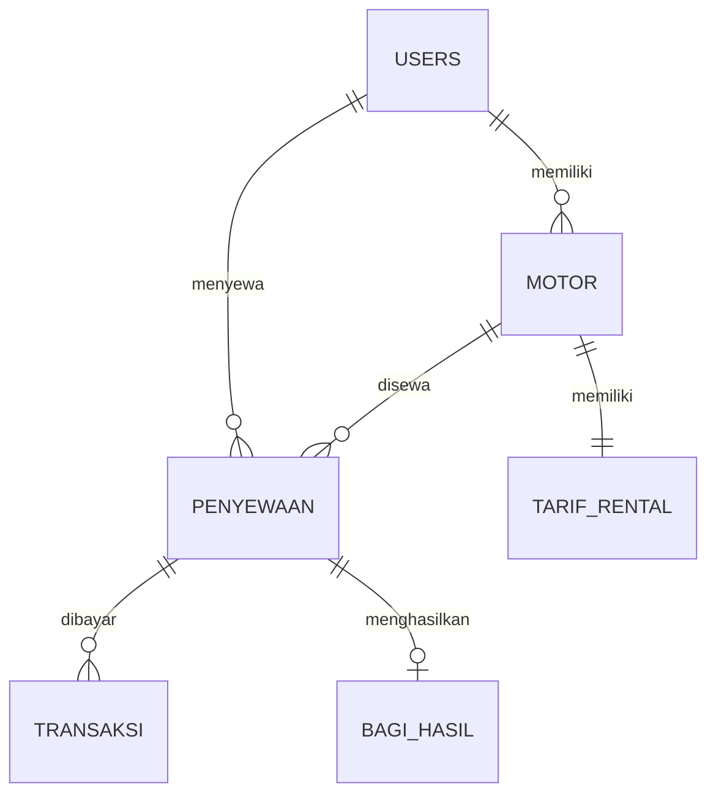

# PRD – Sistem Penyewaan Motor

**Produk:** Aplikasi Web Sistem Penyewaan Motor **Skema:** Pemrogram Junior (Junior Coder) – TPD FR.IA.02 **Versi:** 1.0 (Draft) **Tanggal:** 9 November 2026 **Durasi pengerjaan:** 16 jam **Stack:** Laravel (PHP), Blade, Vite, MySQL/MariaDB, HTML, CSS, JavaScript

---

## 1. Ringkasan Produk

Sistem Penyewaan Motor adalah aplikasi berbasis web yang mempertemukan tiga pihak: **Penyewa** (pelanggan yang menyewa motor), **Pemilik** (pemilik kendaraan yang menitipkan motornya untuk disewakan), dan **Admin** (pemilik usaha persewaan yang memverifikasi motor, menetapkan tarif, mengonfirmasi pesanan, serta mengelola pembayaran dan bagi hasil).

Aplikasi menggantikan proses manual (catatan kertas, chat, dan transfer tanpa pelacakan) dengan alur digital yang tercatat otomatis: dari pendaftaran motor, verifikasi, pemesanan, pembayaran, pengembalian, sampai laporan pendapatan dan bagi hasil.

## 2. Latar Belakang dan Masalah

| Masalah saat ini | Dampak |
| --- | --- |
| Data motor dan status (disewa, tersedia, perawatan) tidak terpusat | Motor double-booking, sulit memantau ketersediaan |
| Tarif ditetapkan tidak konsisten | Harga membingungkan, rawan sengketa |
| Pembayaran dan bagi hasil dicatat manual | Salah hitung, pemilik kendaraan tidak percaya |
| Laporan dibuat manual | Lama dan tidak akurat |

## 3. Tujuan dan Indikator Keberhasilan

| Tujuan | Indikator |
| --- | --- |
| Digitalisasi alur sewa end-to-end | Seluruh 6 alur sistem berjalan tanpa langkah manual di luar aplikasi |
| Transparansi harga dan bagi hasil | Biaya sewa dihitung otomatis; bagi hasil tercatat otomatis saat pengembalian dikonfirmasi |
| Akses sesuai peran | 100% fitur mengikuti matriks hak akses (Bagian 6) |
| Kualitas kode | Seluruh skenario uji manual berstatus OK; tidak ada bug kritis pada backend maupun frontend |
| Pengalaman pengguna | Penyewa dapat memesan motor dalam maksimal 4 langkah dari halaman utama |

**Di luar cakupan (non-goals):** integrasi payment gateway sungguhan, aplikasi mobile native, pelacakan GPS, notifikasi WhatsApp/SMS. Metode pembayaran disimulasikan dan dikonfirmasi manual oleh Admin.

## 4. Pengguna dan Peran

| Peran | Deskripsi | Kebutuhan utama |
| --- | --- | --- |
| **Penyewa** | Pelanggan yang menyewa motor | Cari motor berdasarkan merek dan jenis cc, pilih paket, bayar, lihat status dan riwayat |
| **Pemilik** | Pemilik kendaraan yang menitipkan motor | Daftarkan motor, pantau status motor, lihat laporan bagi hasil |
| **Admin** | Pemilik persewaan / petugas | Verifikasi motor, atur tarif, konfirmasi pesanan dan pembayaran, kelola bagi hasil, laporan |

## 5. Alur Sistem (User Flow)

1. **Pemilik** mendaftarkan motor (merek, jenis cc, nomor polisi, foto, dokumen kepemilikan). Status awal: *menunggu verifikasi*.
2. **Admin** memverifikasi motor dan menetapkan tarif sewa (harian, mingguan, bulanan). Status berubah menjadi *tersedia*.
3. **Penyewa** memilih motor, memilih durasi (harian/mingguan/bulanan), dan sistem menghitung biaya otomatis.
4. **Penyewa** membayar, lalu **Admin** mengonfirmasi. Status motor berubah menjadi *disewa*.
5. Setelah waktu sewa habis, motor dikembalikan dan **Admin** mengonfirmasi pengembalian. Status motor kembali *tersedia*.
6. Sistem otomatis mencatat pendapatan: laporan bagi hasil untuk **Pemilik** dan laporan penyewaan untuk **Admin**.

Status penyewaan: `menunggu_pembayaran` → `menunggu_konfirmasi` → `berjalan` → `selesai` (atau `dibatalkan`). Status motor: `menunggu_verifikasi` → `tersedia` ⇄ `disewa` / `perawatan` (atau `ditolak`).

## 6. Hak Akses (Matriks Privilege)

| Fitur | Admin | Pemilik | Penyewa |
| --- | :-: | :-: | :-: |
| Registrasi |  | ✓ | ✓ |
| Login | ✓ | ✓ | ✓ |
| Logout | ✓ | ✓ | ✓ |
| CRUD data user | ✓ |  |  |
| CRUD data motor | ✓ | ✓ |  |
| CRUD data tarif rental | ✓ |  |  |
| CRUD data penyewaan | ✓ |  | ✓ |
| CRUD data pembayaran | ✓ |  |  |
| Entri transaksi pembayaran | ✓ |  |  |
| Lihat history bagi hasil | ✓ | ✓ |  |
| Grafik penyewaan per periode | ✓ |  |  |
| Generate riwayat penyewaan | ✓ |  | ✓ |
| Generate daftar motor terdaftar | ✓ |  |  |
| Generate daftar motor disewa | ✓ | ✓ |  |
| Generate total pendapatan | ✓ | ✓ |  |
| Generate laporan pembayaran | ✓ |  |  |

Catatan: Pemilik hanya dapat mengelola motor miliknya sendiri; Penyewa hanya dapat mengelola penyewaan miliknya sendiri. Registrasi publik hanya untuk Pemilik dan Penyewa; akun Admin dibuat langsung di database (seeder).

## 7. Kebutuhan Fungsional

### 7.1 Autentikasi dan Akun

- **FR-01** Registrasi dengan nama, email, no. telepon, password, dan pilihan peran (Pemilik/Penyewa). Email harus unik.
- **FR-02** Login (Laravel Sanctum/JWT untuk API, session guard untuk web) dan logout. Password disimpan dengan hash (`Hash::make`).
- **FR-03** Pengalihan otomatis ke dashboard sesuai peran setelah login.
- **FR-04** Admin dapat menambah, melihat, mengubah, dan menghapus data user.

### 7.2 Manajemen Motor

- **FR-05** Pemilik mendaftarkan motor: merek, tipe cc (100/125/150), nomor polisi, foto, dokumen kepemilikan (upload dengan validasi tipe dan ukuran).
- **FR-06** Pemilik dapat memiliki lebih dari satu motor dan melihat status tiap motor (disewa, tersedia, perawatan).
- **FR-07** Admin memverifikasi atau menolak motor yang dititipkan.
- **FR-08** Admin dan Pemilik dapat mengubah/menghapus data motor (Pemilik hanya miliknya).

### 7.3 Tarif

- **FR-09** Admin menetapkan tarif harian, mingguan, dan bulanan per motor (CRUD tarif rental).

### 7.4 Pencarian dan Pemesanan (Penyewa)

- **FR-10** Pencarian motor berdasarkan merek dan jenis cc (100/125/150); hanya motor berstatus *tersedia* yang tampil.
- **FR-11** Pemilihan paket sewa (harian/mingguan/bulanan) dan tanggal mulai; tanggal selesai dan total biaya dihitung otomatis.
- **FR-12** Validasi bentrok jadwal: motor tidak dapat dipesan pada rentang tanggal yang sudah terisi.
- **FR-13** Penyewa melihat status penyewaan dan riwayat sewa pada akunnya.

### 7.5 Pembayaran dan Konfirmasi

- **FR-14** Penyewa melakukan pembayaran sewa (metode: transfer, e-wallet, tunai; simulasi).
- **FR-15** Admin mengonfirmasi pembayaran dan pesanan; status motor menjadi *disewa*.
- **FR-16** Admin mengonfirmasi pengembalian motor; status motor kembali *tersedia*.
- **FR-17** Admin dapat mengentri transaksi pembayaran secara manual dan melakukan CRUD data pembayaran.

### 7.6 Bagi Hasil Otomatis

- **FR-18** Saat pengembalian dikonfirmasi, sistem otomatis membuat catatan bagi hasil (bagian Pemilik dan bagian Admin) melalui trigger/stored procedure.
- **FR-19** Persentase bagi hasil bersifat konfigurasi (asumsi awal: 70% Pemilik, 30% Admin; dapat diubah Admin).

### 7.7 Laporan

| Laporan | Pengguna | Isi |
| --- | --- | --- |
| Laporan Penyewa | Penyewa | Riwayat penyewaan, status aktif, pembayaran |
| Laporan Pemilik | Pemilik | Daftar motor disewakan, pendapatan per motor, total bagi hasil |
| Laporan Admin | Admin | Jumlah motor terdaftar dan disewa, total pendapatan (bagi hasil pemilik dan admin), grafik penyewaan per periode (harian, mingguan, bulanan) |

- **FR-20** Semua laporan dapat difilter berdasarkan periode dan dicetak/diekspor (cetak browser atau CSV).

## 8. Model Data

### 8.1 Entitas dan Tipe Data

**USERS**

| Field | Tipe | Keterangan |
| --- | --- | --- |
| id | INT UNSIGNED, PK, AUTO\_INCREMENT |  |
| nama | VARCHAR(100), NOT NULL |  |
| email | VARCHAR(100), UNIQUE, NOT NULL |  |
| password | VARCHAR(255), NOT NULL | Hash (ditambahkan untuk kebutuhan login) |
| no\_tlpn | VARCHAR(20) |  |
| role | ENUM('penyewa','pemilik','admin') |  |

**MOTOR**

| Field | Tipe | Keterangan |
| --- | --- | --- |
| id | INT UNSIGNED, PK, AUTO\_INCREMENT |  |
| pemilik\_id | INT UNSIGNED, FK → users.id |  |
| merk | VARCHAR(50), NOT NULL |  |
| tipe\_cc | ENUM('100','125','150') |  |
| no\_plat | VARCHAR(15), UNIQUE, NOT NULL |  |
| status | ENUM('menunggu\_verifikasi','tersedia','disewa','perawatan','ditolak') | Default: menunggu\_verifikasi |
| photo | VARCHAR(255) | Path file |
| dokumen\_kepemilikan | VARCHAR(255) | Path file |

**TARIF\_RENTAL**

| Field | Tipe | Keterangan |
| --- | --- | --- |
| id | INT UNSIGNED, PK, AUTO\_INCREMENT |  |
| motor\_id | INT UNSIGNED, FK → motor.id, UNIQUE |  |
| tarif\_harian | DECIMAL(12,2) |  |
| tarif\_mingguan | DECIMAL(12,2) |  |
| tarif\_bulanan | DECIMAL(12,2) |  |

**PENYEWAAN**

| Field | Tipe | Keterangan |
| --- | --- | --- |
| id | INT UNSIGNED, PK, AUTO\_INCREMENT |  |
| penyewa\_id | INT UNSIGNED, FK → users.id |  |
| motor\_id | INT UNSIGNED, FK → motor.id |  |
| tanggal\_mulai | DATE |  |
| tanggal\_selesai | DATE |  |
| tipe\_durasi | ENUM('harian','mingguan','bulanan') |  |
| harga | DECIMAL(12,2) | Total biaya hasil hitung |
| status | ENUM('menunggu\_pembayaran','menunggu\_konfirmasi','berjalan','selesai','dibatalkan') |  |

**TRANSAKSI**

| Field | Tipe | Keterangan |
| --- | --- | --- |
| id | INT UNSIGNED, PK, AUTO\_INCREMENT |  |
| pemesanan\_id | INT UNSIGNED, FK → penyewaan.id |  |
| jumlah | DECIMAL(12,2) |  |
| metode\_pembayaran | ENUM('transfer','ewallet','tunai') |  |
| status | ENUM('pending','berhasil','gagal') |  |
| tanggal | DATETIME |  |

**BAGI\_HASIL**

| Field | Tipe | Keterangan |
| --- | --- | --- |
| id | INT UNSIGNED, PK, AUTO\_INCREMENT |  |
| pemesanan\_id | INT UNSIGNED, FK → penyewaan.id |  |
| bagi\_hasil\_pemilik | DECIMAL(12,2) |  |
| bagi\_hasil\_admin | DECIMAL(12,2) |  |
| settled\_at | DATETIME, NULL | Waktu penyelesaian |
| tanggal | DATE |  |

### 8.2 Relasi (Diagram ER)

### 8.3 Objek Database

| Jenis | Nama | Fungsi |
| --- | --- | --- |
| Stored procedure | `sp_buat_penyewaan` | Hitung harga dari tarif dan durasi, cek bentrok jadwal, simpan penyewaan |
| Stored procedure | `sp_konfirmasi_pengembalian` | Ubah status penyewaan ke selesai dan motor ke tersedia |
| Function | `fn_hitung_biaya(motor_id, tipe_durasi, jumlah)` | Mengembalikan total biaya sewa |
| Function | `fn_total_pendapatan(periode)` | Total pendapatan per periode |
| Trigger | `trg_motor_disewa` | Setelah pembayaran berhasil, set status motor = disewa |
| Trigger | `trg_bagi_hasil` | Setelah penyewaan selesai, otomatis isi tabel bagi\_hasil |
| View | `v_laporan_admin`, `v_laporan_pemilik`, `v_riwayat_penyewa` | Dasar laporan |

**Implementasi Laravel:** tabel dibuat lewat *migration* dan data dummy (termasuk akun Admin) lewat *seeder*/*factory*. Stored procedure, function, trigger, dan view dibuat di dalam migration memakai `DB::unprepared()`, lalu dipanggil dengan `DB::select('CALL ...')`. Tiap tabel dipetakan ke model Eloquent (`User`, `Motor`, `TarifRental`, `Penyewaan`, `Transaksi`, `BagiHasil`) dengan relasi `hasMany`, `belongsTo`, dan `hasOne`. Kolom `created_at` dan `updated_at` ditambahkan otomatis oleh Laravel.

## 9. Spesifikasi API (REST)

| Grup | Method dan Endpoint | Fungsi | Peran |
| --- | --- | --- | --- |
| Auth | `POST /auth/register` | Daftar akun | Publik |
| Auth | `POST /auth/login` | Login (JWT) | Publik |
| Pemilik | `POST /owner/motors` | Titip motor | Pemilik |
| Pemilik | `GET /owner/motors` | Daftar motor dan status | Pemilik |
| Pemilik | `GET /owner/revenue` | Laporan bagi hasil | Pemilik |
| Penyewa | `GET /motors` | Lihat motor tersedia (filter merek, cc) | Penyewa |
| Penyewa | `POST /bookings` | Pesan motor | Penyewa |
| Penyewa | `POST /payments` | Bayar sewa | Penyewa |
| Penyewa | `GET /bookings/history` | Histori penyewaan | Penyewa |
| Admin | `PATCH /admin/motors/:id/verify` | Verifikasi motor | Admin |
| Admin | `PATCH /admin/bookings/:id/confirm` | Konfirmasi pesanan | Admin |
| Admin | `GET /admin/reports/revenue` | Laporan pendapatan dan bagi hasil | Admin |

Standar respons: JSON `{ success, message, data }`, kode HTTP yang sesuai (200, 201, 400, 401, 403, 404, 422), dan middleware pengecekan peran pada setiap endpoint terlindungi.

**Implementasi Laravel:** endpoint didefinisikan di `routes/api.php` (prefix `/api`), dilindungi middleware `auth:sanctum` dan middleware peran (`role:admin`, `role:pemilik`, `role:penyewa`). Parameter `:id` pada tabel ditulis `{id}` di route Laravel, mis. `PATCH /admin/motors/{motor}/verify`. Bila asesor mewajibkan JWT, pakai paket `tymon/jwt-auth` sebagai pengganti Sanctum. Respons memakai API Resource.

## 10. Spesifikasi Desain UI/UX

### 10.1 Referensi Visual

Desain mengacu pada gaya landing page "Kiwi" (AI vector illustration): **bersih, lapang, dominan putih, ilustrasi line-art hitam dengan aksen hijau muda tunggal**, kartu dengan border tipis, dan tombol hijau pill. Semua konten dan ilustrasi disesuaikan menjadi tema rental motor.

**Implementasi Laravel:** tampilan dibangun dengan Blade (layout `app` dan `guest`, komponen seperti `<x-card>`, `<x-button>`, `<x-badge-status>`), aset dikelola Vite, design tokens dipasang sebagai CSS variable atau konfigurasi Tailwind, dan grafik dashboard memakai Chart.js.

### 10.2 Design Tokens

| Token | Nilai | Pemakaian |
| --- | --- | --- |
| `--bg` | `#FFFFFF` | Latar halaman |
| `--ink` | `#0B0B0B` | Teks utama, garis ilustrasi |
| `--ink-muted` | `#6B7280` | Teks sekunder, placeholder |
| `--accent` | `#86EF72` (hijau muda) | CTA utama, ikon, bintang rating, highlight |
| `--accent-soft` | `#EAFBE7` | Latar badge dan hover |
| `--border` | `#E5E7EB` | Border kartu dan input |
| `--border-accent` | `#86EF72` | Border kartu ilustrasi |
| Radius | 10 px kartu, 8 px input, 999 px tombol/badge |  |
| Bayangan | Sangat tipis, `0 1px 2px rgba(0,0,0,.05)` |  |

**Tipografi:** sans-serif geometris (Urbanist atau Outfit via Google Fonts; fallback system-ui). Judul hero 56 px / weight 500 / line-height 1.1; sub-judul 14 px abu-abu; navigasi 12–13 px. Skala: 12 / 14 / 16 / 24 / 36 / 56.

**Ilustrasi:** line-art hitam (stroke 2–3 px) dengan satu elemen berwarna hijau (mis. roda, kunci, tanda centang). Tema: motor, helm, kunci, peta, kalender, dompet, dokumen. Dibuat sebagai SVG agar tajam dan ringan.

**Komponen:**

- **Tombol utama:** pill hijau, teks hitam kecil ("Sewa Sekarang"). **Tombol sekunder:** pill abu-abu muda berteks hitam.
- **Kartu:** putih, border tipis, radius 10 px; versi ilustrasi memakai border hijau.
- **Input:** abu-abu sangat muda, tanpa border tebal, tombol hijau menyatu di sisi kanan (seperti kolom email hero).
- **Badge status:** hijau (tersedia), kuning (menunggu), abu (perawatan), hitam (disewa).

### 10.3 Halaman Publik (Landing Page)

| Seksi | Isi (adaptasi dari referensi) |
| --- | --- |
| **Navbar** | Logo di kiri; menu Beranda, Fitur, Tentang, Paket, Kontak; kanan: tombol "Masuk" (sekunder) dan "Daftar" (hijau) |
| **Hero** | Judul besar 3 baris, mis. "Sewa Motor Mudah, Cepat, dan Transparan"; deskripsi singkat; kolom pencarian cepat (merek / cc) dengan tombol hijau "Cari Motor"; di kanan ilustrasi line-art besar (pengendara dan motor dengan aksen hijau) |
| **Statistik** | Dua angka besar dengan label (mis. "150+ Motor tersedia", "1.200+ Transaksi"), garis pemisah vertikal tipis, dan baris bintang rating hijau |
| **Strip mitra** | Teks "Merek tersedia" dengan logo teks Honda, Yamaha, Suzuki, Kawasaki, Vespa (grayscale) |
| **Showcase kartu** | Baris kartu ilustrasi berborder hijau yang bergulir horizontal; di tengah panel kaca buram (blur) berisi judul "Temukan Motor Impianmu", deskripsi, dan dua tombol (Mulai, Daftar Gratis) |
| **Fitur (bento grid)** | Judul "Kenapa Sewa di Sini" dengan tombol Daftar dan Jelajahi di kanan. Grid 2×2 kartu: **Pencarian Instan** (kolom contoh pencarian + ilustrasi), **Aman dan Terpercaya** (kartu pusat berikon hijau dengan garis sirkuit), **Paket Fleksibel** (harian/mingguan/bulanan), **Bagi Hasil Otomatis** (tiga kartu putus-putus ilustrasi) |
| **Cara Kerja** | 3–4 langkah: Pilih motor → Pilih durasi → Bayar → Ambil motor |
| **CTA akhir dan Footer** | Ajakan daftar sebagai Penyewa atau Pemilik; tautan, kontak |

### 10.4 Halaman Aplikasi per Peran

Tata letak dashboard: sidebar kiri putih ramping (ikon + label, item aktif berlatar hijau lembut), header atas dengan nama pengguna dan tombol logout, konten berupa kartu-kartu statistik dan tabel bergaya minimal.

**Penyewa**

- Dashboard: sewa aktif, ringkasan biaya, rekomendasi motor.
- Cari Motor: filter merek dan cc, kartu motor (foto, merek, cc, tarif per paket, tombol Pesan).
- Form Pemesanan: pilih paket dan tanggal, ringkasan biaya real-time.
- Pembayaran: pilih metode, instruksi, unggah bukti.
- Riwayat dan Status: tabel penyewaan dengan badge status; cetak riwayat.

**Pemilik**

- Dashboard: jumlah motor, motor disewa, total bagi hasil bulan ini.
- Motor Saya: daftar dengan badge status; form titip motor (unggah foto dan dokumen, pratinjau).
- Laporan Bagi Hasil: tabel pendapatan per motor, total, filter periode, cetak.

**Admin**

- Dashboard: kartu (motor terdaftar, motor disewa, pendapatan, pesanan menunggu) dan grafik penyewaan harian/mingguan/bulanan.
- Verifikasi Motor: antrean dengan pratinjau foto/dokumen, tombol Setujui/Tolak, form tarif.
- Kelola Pesanan dan Pembayaran: konfirmasi pesanan, entri transaksi, konfirmasi pengembalian.
- Kelola User, Motor, Tarif: tabel CRUD dengan pencarian dan paginasi.
- Laporan: riwayat, daftar motor, total pendapatan, pembayaran; filter periode, cetak/CSV.

### 10.5 Prinsip UX

- Maksimal 4 langkah dari beranda ke pemesanan; pencarian tersedia langsung di hero.
- Form pelaporan komunikatif: label jelas, filter periode di atas, ringkasan angka sebelum tabel, empty state berilustrasi.
- Validasi inline dengan pesan bahasa Indonesia yang spesifik; konfirmasi sebelum aksi destruktif.
- Responsif (mobile-first: 360 px, 768 px, 1280 px); target sentuh minimal 44 px.
- Aksesibilitas: kontras teks minimal 4.5:1 (teks hitam di atas hijau muda memenuhi), fokus keyboard terlihat, alt text pada gambar.
- **Multimedia:** foto motor, ilustrasi SVG, animasi halus (fade/slide-in, hover kartu), dan galeri/lightbox foto motor.

## 11. Kebutuhan Non-Fungsional

| Kategori | Persyaratan |
| --- | --- |
| Keamanan | Eloquent/Query Builder dengan parameter binding untuk mencegah SQL injection; `Hash::make`/`Hash::check`; escape output otomatis Blade (XSS); proteksi CSRF bawaan (@csrf) pada form; validasi upload lewat Form Request (mimes, max) dan penyimpanan via Storage; otorisasi per peran di sisi server lewat middleware, Gate, dan Policy |
| Performa | Halaman utama dimuat di bawah 3 detik pada koneksi lokal; indeks pada kolom FK dan `no_plat` |
| Keandalan | Transaksi database (DB::transaction) untuk pembayaran dan bagi hasil; log kesalahan |
| Kompatibilitas | Browser modern (Chrome, Firefox, Edge) pada Windows 10/Linux |
| Maintainability | Struktur MVC Laravel (Model, Controller, Form Request, Policy), penamaan konsisten, komentar dan dokumentasi fungsi |

## 12. Standar Kode dan Dokumentasi

- Mengikuti coding guidelines dan best practices (PSR-12 dan konvensi Laravel, penamaan jelas, tanpa duplikasi, pemisahan logika dan tampilan).
- Dokumentasi fungsi, prosedur, dan method dengan docblock (tujuan, parameter, return).
- Program dikompilasi/dijalankan tanpa error dengan php artisan serve (MySQL via XAMPP/Laragon) dan aset dibuild dengan Vite.
- Debugging backend dan frontend sampai seluruh fitur berfungsi.

## 13. Rencana Pengujian

Pengujian manual memakai format instrumen: **No, Skenario, Class, Method, Data Input, Expected Result, Actual Result, Status**. Contoh skenario minimum:

| No | Skenario | Class | Method | Data Input | Expected |
| --- | --- | --- | --- | --- | --- |
| 1 | Login sukses | Auth | do\_login | admin / password benar | Return true |
| 2 | Username salah | Auth | do\_login | adminx / password benar | Return false |
| 3 | Login dengan SQL injection | Auth | do\_login | `' or ''='` | Return false |
| 4 | Registrasi email duplikat | Auth | do\_register | Email sudah ada | Ditolak dengan pesan |
| 5 | Titip motor valid | Motor | create | Data lengkap + foto | Tersimpan, status menunggu\_verifikasi |
| 6 | Upload file bukan gambar | Motor | create | File .exe | Ditolak |
| 7 | Hitung biaya 3 hari | Booking | hitung\_biaya | Tarif 80.000 × 3 | 240.000 |
| 8 | Pesan motor jadwal bentrok | Booking | create | Tanggal terisi | Ditolak |
| 9 | Penyewa akses halaman admin | Middleware | cek\_role | Role penyewa | Akses ditolak (403) |
| 10 | Konfirmasi pengembalian | Admin | confirm\_return | Penyewaan berjalan | Status selesai, bagi hasil otomatis tercatat |
| 11 | Total bagi hasil | Laporan | revenue | Periode bulan ini | Pemilik + Admin = total transaksi |

Seluruh fitur pada matriks hak akses wajib memiliki minimal satu skenario uji.

## 14. Deliverables

1. Aplikasi web Sistem Penyewaan Motor (source code).
2. Rancangan sistem: DFD (Power Designer/tool sejenis), flowchart algoritma, dan diagram ER (CDM/PDM).
3. Database MySQL (migration dan seeder) lengkap dengan stored procedure, function, trigger, dan data dummy.
4. UI/UX seluruh peran beserta dashboard dan aset (ikon, ilustrasi, foto).
5. Dokumentasi fungsi/prosedur/method.
6. Instrumen manual testing terisi.
7. Demonstrasi hasil kepada asesor.

## 15. Rencana Waktu (16 Jam)

| Fase | Durasi | Hasil |
| --- | --- | --- |
| Analisis dan perancangan (DFD, ER, flowchart) | 2 jam | Diagram dan skema data |
| Setup Laravel dan database (migration, model, seeder, procedure, function, trigger) | 2 jam | File SQL |
| Backend: autentikasi, role, API/CRUD, logika sewa dan bagi hasil | 5 jam | Fitur berjalan |
| Frontend (Blade + Vite): landing page, dashboard tiap peran, laporan dan grafik | 4 jam | UI lengkap |
| Debugging dan pengujian manual | 2 jam | Instrumen uji terisi |
| Dokumentasi dan persiapan demo | 1 jam | Dokumen akhir |

## 16. Perlengkapan

PC/laptop (Quad Core 3 GHz, RAM 8 GB, SSD 256 GB), Windows 10/Linux, web browser, code editor, web server/MySQL (XAMPP/Laragon), PHP, Composer, Laravel versi stabil terbaru, Node.js (untuk Vite), HTML dan CSS, file aset, diagram alur data, dan data dummy.

## 17. Asumsi, Risiko, dan Pertanyaan Terbuka

| Item | Keterangan |
| --- | --- |
| Asumsi | Persentase bagi hasil awal 70:30 dan dapat dikonfigurasi; pembayaran disimulasikan dan dikonfirmasi manual oleh Admin; satu motor memiliki satu set tarif |
| Asumsi | Tabel USERS ditambah kolom `password` karena dibutuhkan untuk login |
| Risiko | Waktu 16 jam ketat: prioritaskan alur inti (daftar motor → verifikasi → pesan → bayar → kembali → laporan) sebelum polesan visual |
| Risiko | Bentrok jadwal dan perhitungan bagi hasil rawan bug: uji dengan data dummy bervariasi |
| Terbuka | Apakah denda keterlambatan dan deposit perlu ada? (saat ini di luar cakupan) |
| Terbuka | Apakah Admin boleh membuat Admin lain melalui UI? (saat ini lewat seeder) |
| Asumsi | Aplikasi dibangun sebagai monolit Laravel (Blade); endpoint REST disediakan di routes/api.php dengan Sanctum, dan JWT hanya bila diminta asesor |

## 18. Kriteria Penerimaan (Acceptance Criteria)

- Keenam alur sistem berjalan lengkap dari data awal sampai laporan.
- Setiap peran hanya dapat mengakses fitur sesuai matriks pada Bagian 6.
- Biaya sewa dan bagi hasil dihitung otomatis dan akurat.
- Tampilan konsisten dengan design tokens Bagian 10 dan responsif.
- Seluruh skenario pada instrumen uji berstatus OK; tidak ada celah SQL injection pada login.
- Dokumentasi, diagram, dan database lengkap dan dapat didemokan kepada asesor.
